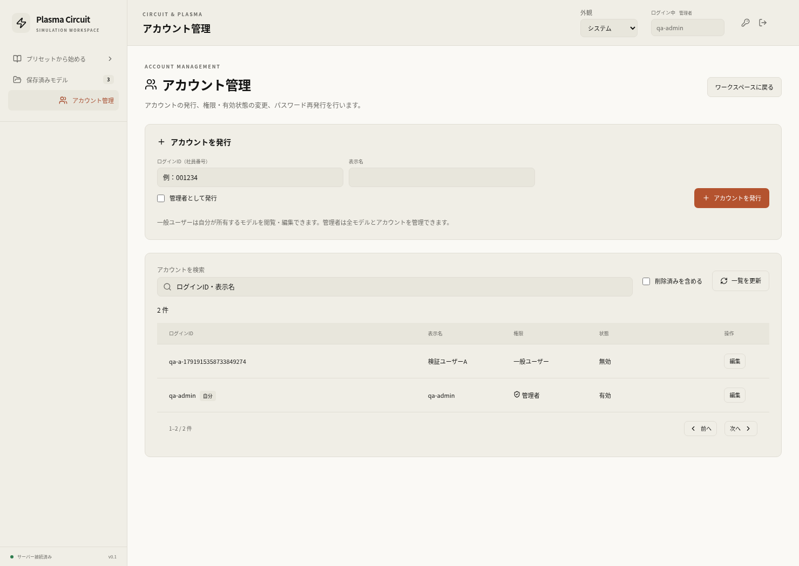
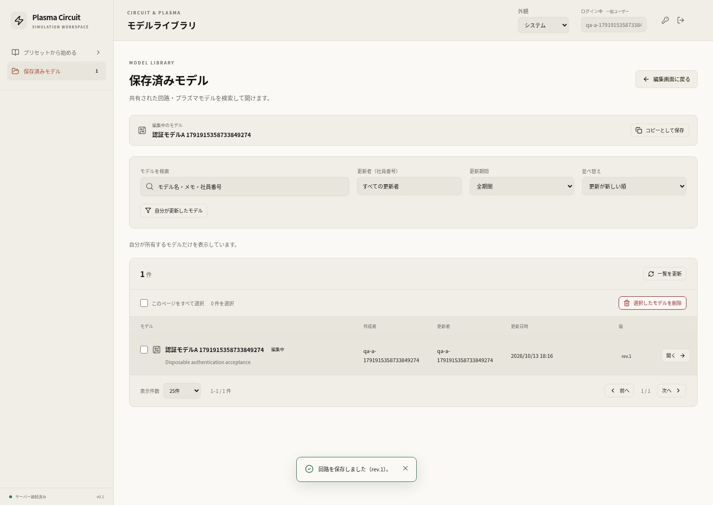
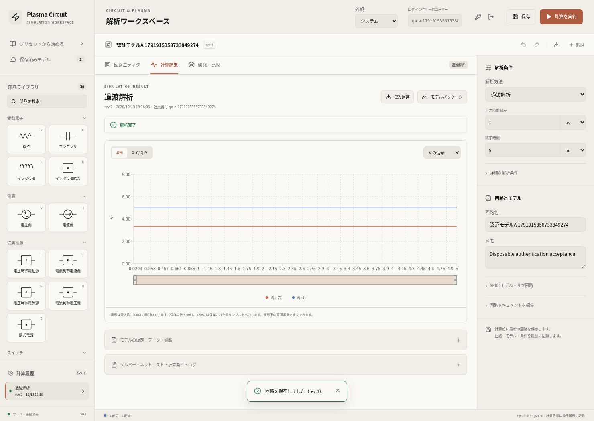
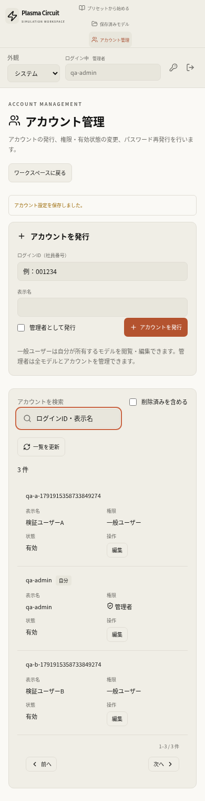

# ログイン・アカウント管理・所有者制限の検証

確認日：2026-10-13。社員番号をログインIDとするパスワード認証、管理者によるアカウント発行・無効化・削除・権限変更・仮パスワード再発行を追加した。一般ユーザーは所有するモデルとその計算・研究履歴だけにアクセスし、管理者は全モデルと所有者割り当てを管理する。操作・初期設定は[アカウント管理](../../docs/accounts.md)を参照。

APIでも所有者を確認し、他人のモデルID・run ID・study IDを直接指定した閲覧・編集・削除・実行・停止・再開・比較・CSV・パッケージ取得を拒否する。新規保存とインポートはログイン中のアカウントを所有者とし、送信された社員番号で操作履歴を偽装できない。参照データも所有者に従って絞り込む。

認証追加前のモデルは未割当として管理者だけに表示する。管理者はモデル一覧から有効なアカウントへ割り当てられる。変更時は版を更新し、更新競合があれば一括操作を中止する。モデルにひもづく履歴のアクセス権も移るが、入力・計算値・計算時のノード名を変更しない。

## 確認結果

| 対象 | 結果 | 確認範囲 |
| --- | --- | --- |
| Dockerバックエンド全体 | 581 passed、警告1、320.10 s、終了コード0 | 新規の認証・権限60ケースとワーカー接続2ケース、保存・API・研究・削除・移行、通常回路・EDD・同軸・プラズマなど既存の数値テスト |
| フロントエンド | TypeScript検査・Vite本番ビルド成功 | 最終配備は所有者選択のアクセシブルな名前と、アカウント用モーダル内のキーボード保護を含む。既存のchunk-size advisoryあり |
| アカウントの実ブラウザ受入 | 12チェック合格、runtime error 0 | 発行、初回変更、本人の変更、仮パスワード再発行、権限・有効状態変更、削除、一般ユーザー2人のモデル分離、管理者アクセス、所有者変更、390pxモバイル、同時管理操作 |
| 実キュー・実ソルバー | 3ジョブ成功 | UIでの実行1件と2人からの同時HTTP投入。5V/1kΩ/2kΩの出力3.333333333V、12Vの場合8V。PySpice 1.5 / ngspice 39 |
| ノード名のブラウザ回帰 | 8チェック合格、実ジョブ2件、runtime error 0 | ログイン付きで編集・凡例・過渡/AC・CSV・保存履歴・モバイルを再確認 |
| 素子複製のブラウザ回帰 | 6チェック合格、実ジョブ1件、runtime error 0 | 全30種別、個別編集・ショートカット・入力保護・保存再読込・実計算をログイン付きで確認 |
| 認証付きAPIスモーク | 3チェック合格、実ジョブ3件 | 分圧・RC・EDD、実DB保存・版競合・入力スナップショット・CSV。送信値に依存しない社員番号と所有者 |
| ワーカーの停止・待機回帰 | 2チェック合格 | 実RQの待機ジョブ・実行中ngspiceの停止、12秒待機後の次ジョブ実行 |
| 実Redis PubSubの待機確認 | 合格 | RQ既定の通信期限11秒を超える13秒待機後、受信スレッドが生存し、実際の通知を受信 |
| 共有DBの移行 | 合格 | 有効モデル60件を含む既存8テーブルの全行を移行前後で比較。新しい所有者列を除き、回路・版・結果・研究・来歴は不変。全151モデルは未割当で、指定されたadminだけを新規作成 |

本人のパスワード変更は他のログインを解除し、操作した画面のセッションを更新する。編集中の内容は保持し、パスワードモーダルでCtrl+Dを押しても背後の部品を複製しない。管理者による権限変更・無効化・削除・再発行は対象者のログインを解除した。削除してもモデルと成功した計算履歴は残る。

PostgreSQLで管理者2人が互いの管理者権限・有効状態を同時に解除する試行を行った。応答は200と403で、有効な管理者は1人残った。その管理者自身の削除も409で拒否した。

追加の停止確認で、RQ 2.2がワーカーの明示的な `socket_timeout=None` を有限の期限に置き換え、長い待機後にPubSub受信スレッドが終了する既存の問題を確認した。停止要求後も計算プロセスが残り、次のジョブが待たされていた。ワーカー用サブクラスで明示的な無期限読み取りを維持し、API用接続の短い期限は保持する。実Redisの短いTTLを使って期限超過後の通知受信を確認し、実ワーカーの停止・次ジョブ実行も再確認した。

ブラウザ・実キュー確認は専用のPostgreSQL/Redis/Docker環境で実行し、API・ソルバーの応答をモックしていない。共有DBでは読み取りによる移行確認と、ユーザー指定の初期adminの作成だけを行った。バックエンド単体テストにはキューをモックするケースがある。これらは認証・機能・数値の確認であり、新しい実験バリデーションを追加したものではない。

## 証跡と再実行

- [全バックエンドの出力](backend-tests.txt)
- [認証のmanifest](verification.json)：12チェック、3つの実run、同時管理操作、配備資産・対象ソースのSHA-256
- [移行の確認](migration.json)：既存テーブルの保持件数と所有者未割当を確認
- [ノード名の回帰](node-labels-regression/verification.json)
- [素子複製の回帰](duplication-regression/verification.json)
- [認証付きAPIスモーク](api-smoke.txt)
- [停止・待機の実キュー確認](job-control.txt)
- [PubSub受信の確認](worker-pubsub.json)

```bash
docker compose -f compose.yaml -f compose.cloud.yaml run --rm --no-deps api timeout 600 python -X faulthandler -m pytest -q -o faulthandler_timeout=120 --tb=short
python scripts/check_accounts.py --base-url http://localhost:8081 --admin-file .private/auth-test-admin.json --confirm-isolated-test-db
python scripts/check_node_labels.py --base-url http://localhost:8081 --auth-file .private/auth-test-admin.json --output reports/accounts/node-labels-regression
python scripts/check_component_duplication.py --base-url http://localhost:8081 --auth-file .private/auth-test-admin.json --output reports/accounts/duplication-regression
python scripts/smoke.py --base-url http://localhost:8081 --auth-file .private/auth-test-admin.json
python scripts/check_jobs.py --base-url http://localhost:8081 --auth-file .private/auth-test-admin.json
docker exec -i plasma-auth-check-api-1 python - < scripts/check_worker_pubsub.py
```

アカウント受入には、使い捨てのDBとコンソールで発行した仮パスワード付き管理者を用意する。ファイル形式は `username` と `password` を持つJSON。最後の同時操作はその管理者も対象にするため、共有の本番DBでは実行しない。仮パスワードやCookieはレポート、スクリーンショット、Gitに含めない。Starletteのanyioに関する既存の非推奨警告1件がある。

専用環境の起動・破棄は[検証用Compose](../../compose.test.yaml)と[初期設定手順](../../docs/accounts.md)を参照。検証完了後、専用コンテナ・ネットワーク・DB/Redisボリュームを破棄した。共有環境はAPI・worker・frontend・DB・Redisが正常稼働し、認証なしのモデル取得が401になることも確認した。

最終配備イメージ：

- API・worker：`sha256:edeb173c331d4effe10134bb2fdc57541a51f8779a674fdaa595899f80fa5f94`
- frontend：`sha256:8aa6d44d26f19b5fae73cfd1ce507405ec22260a88a7cc5aead3951522402cf2`
- JavaScript：`/assets/index-D9h3qiS1.js`、CSS：`/assets/index-DSdSjWVF.css`

認証12チェックとノード名・複製の回帰はワーカー修正前のバックエンド `bb6582d2…` で完走し、認証・API・保存・ソルバーの対象ソースは最終版と同一。ワーカーだけを更新した最終版は全581件と実PubSub・実停止回帰の対象として区別する。








